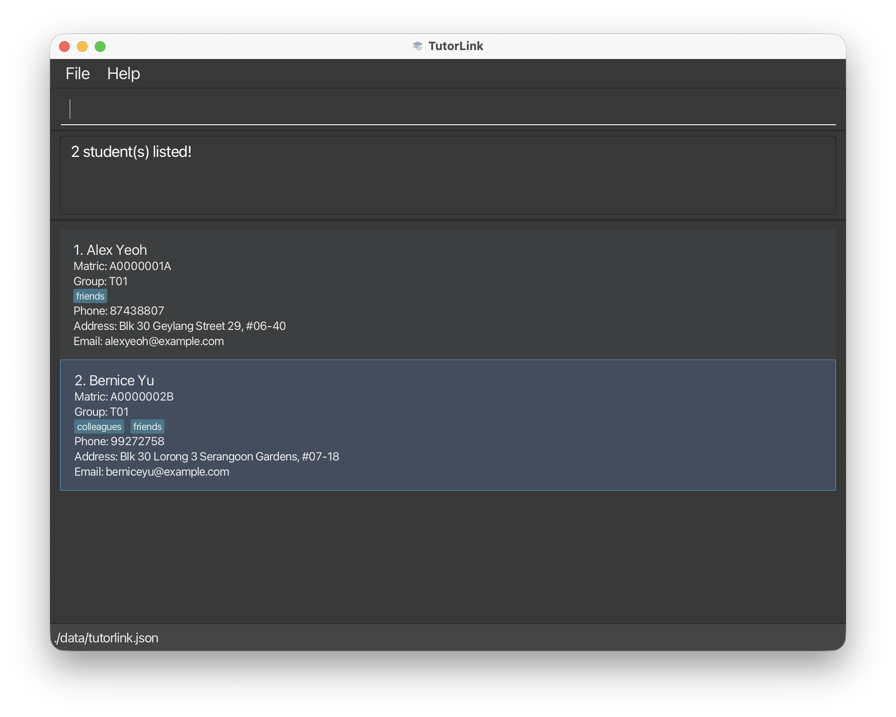
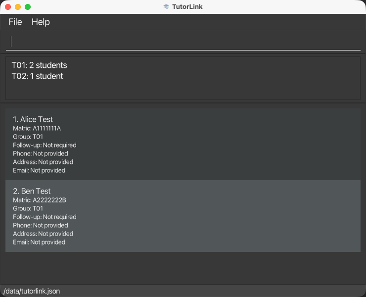
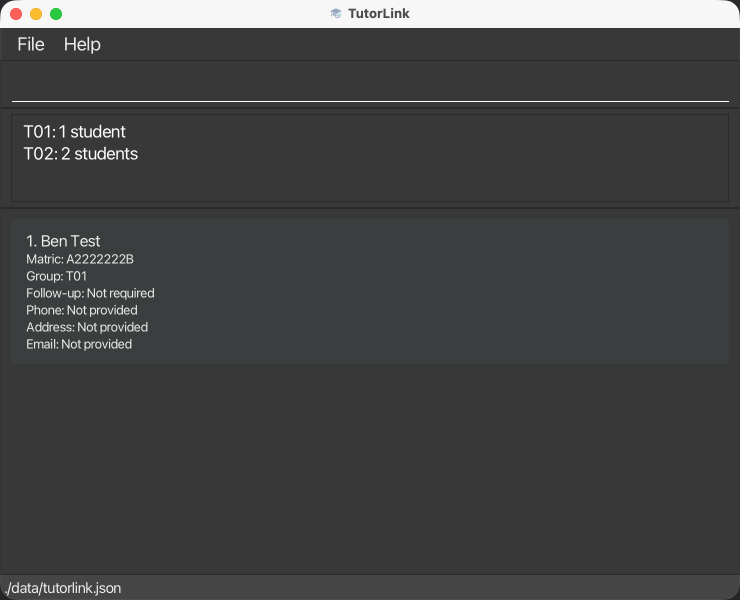
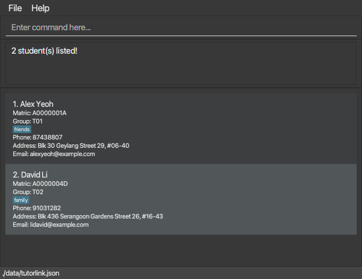
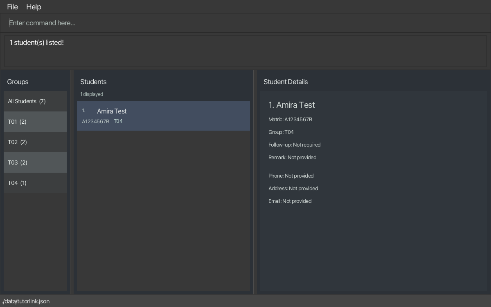
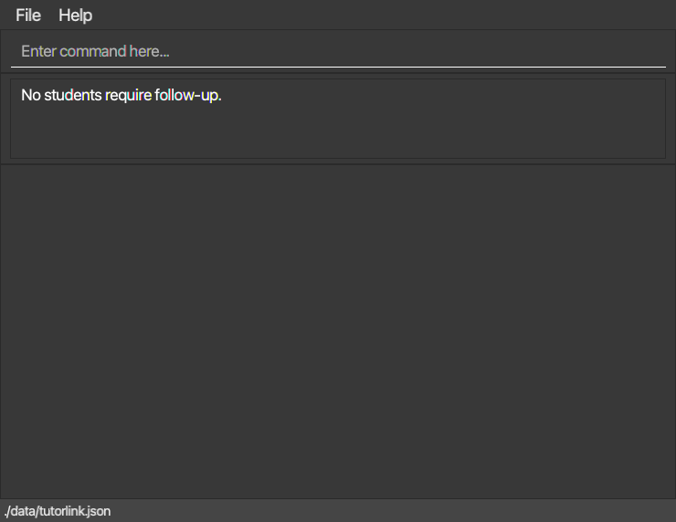

# TutorLink User Guide

TutorLink is a **desktop application for managing student records, optimized for use through a Command Line Interface (CLI)** while retaining the benefits of a Graphical User Interface (GUI). If you type quickly, TutorLink can help you manage students faster than traditional GUI applications.

<!-- * Table of Contents -->
<page-nav-print />

--------------------------------------------------------------------------------------------------------------------

## Quick start

1. Ensure that Java `25` is installed on your computer. Run `java -version` to check.
   **Mac users:** Install Azul JDK **with JavaFX** `25.0.3.fx-zulu`, following the
   [course installation guide](https://se-education.org/guides/tutorials/javaInstallationMac.html).

1. Download the package matching your Java runtime from the [TutorLink releases page](https://github.com/AY2627S1-CS2103T-T13-4/tp/releases):
   * **Windows, Linux, or Intel Mac with x64 Java:** `TutorLink.jar`.
   * **Apple Silicon Mac (M-series) with ARM64 Java:** `TutorLink-mac-aarch64.jar`.
   * On an Apple Silicon Mac using x64 Java through Rosetta, use `TutorLink.jar`.
     Run `java -XshowSettings:properties -version` and look for `os.arch`: `aarch64` means ARM64;
     `x86_64` or `amd64` means x64. The JAR must match the Java runtime's architecture.

1. Copy the file to the folder you want to use as the _home folder_ for TutorLink.

1. Open a terminal, `cd` to the folder containing the JAR file, and run `java -jar TutorLink.jar`
   (or `java -jar TutorLink-mac-aarch64.jar` for the ARM64 package).<br>
   A GUI similar to the one below should appear in a few seconds. Note how the app contains some sample data.<br>
   

1. Type a command in the command box and press Enter to execute it. For example, type **`help`** and press Enter to open the help window.<br>
   Some example commands you can try:

   * `list` : Lists all students.

   * `list g/T01` : Lists only students in tutorial group `T01`.

   * `groups` : Lists every tutorial group and its student count.

   * `sort name` : Sorts the displayed students by name from A to Z.

   * `sort group` : Sorts the displayed students by tutorial group in ascending order.

   * `add n/John Doe m/A0123456X g/T01 e/johnd@example.com` : Adds a student named `John Doe` to TutorLink.

   * `find John` : Finds students whose names contain the whole word `John`.

   * `findtag needsHelp` : Finds students with the tag `needsHelp`, ignoring case.

   * `followup 1 on`, then `followups` : Marks the 1st displayed student and lists outstanding follow-ups.

   * `delete 3` : Previews the 3rd student; use `delete 3 confirm` to delete them.

   * `clear` : Deletes all student records.

   * `exit` : Exits the app.

1. Refer to the [Features](#features) section below for details of each command.

--------------------------------------------------------------------------------------------------------------------

## Features

### Student roster scope

This release focuses on managing a student roster. Tutorial groups are stored as part of each student's record and can be used to filter the roster with `list g/TUTORIAL_GROUP`. Standalone tutorial-group creation, editing, and deletion are not available in this release.

Attendance tracking and participation records are future enhancements and are not available in this version.

<box type="info" seamless>

**Notes about the command format:**<br>

* Words in `UPPER_CASE` are the parameters to be supplied by the user.<br>
  For example, in `add n/NAME`, replace `NAME` with a value such as `John Doe`.

* Items in square brackets are optional.<br>
  For example, `n/NAME [t/TAG]` can be used as `n/John Doe t/friend` or as `n/John Doe`.

* Items followed by `...` can appear zero or more times.<br>
  For example, `[t/TAG]... ` may be omitted, or written as `t/friend` or `t/friend t/family`.

* Parameters can be in any order.<br>
  For example, if the command specifies `n/NAME p/PHONE_NUMBER`, `p/PHONE_NUMBER n/NAME` is also acceptable.
  Positional arguments in `sort name [asc|desc]` and `sort group [asc|desc]` must follow the order shown.

* Extraneous parameters for commands that take no parameters, such as `help`, `exit`, and `clear`, are ignored.<br>
  For example, `help 123` is interpreted as `help`.

* If you are using a PDF version of this document, be careful when copying and pasting commands that span multiple lines as space characters surrounding line-breaks may be omitted when copied over to the application.
</box>

### Viewing help: `help`

Opens a Help window containing the link to the online User Guide. Use the **Copy URL** button in the Help window to copy the link.


Format: `help`


### Adding a student: `add`

Adds a student to TutorLink.

Format: `add n/NAME m/MATRIC_NUMBER g/TUTORIAL_GROUP [p/PHONE_NUMBER] [e/EMAIL] [a/ADDRESS] [t/TAG]... `

The name, matriculation number, and tutorial group are required. Phone number, email, address, and tags are optional.
If omitted, the corresponding contact details are displayed as `Not provided`.
A successful addition clears the current filter and sorting, showing the full roster in directory order
with the new student at the end.

Names can contain letters, digits, and spaces, up to 70 characters after leading/trailing whitespace is removed and consecutive spaces are collapsed. For example, `John  Doe` is saved as `John Doe`.

The matriculation number must be `A` followed by seven digits and a letter. Letter case is ignored on input, and the
value is saved in uppercase. A tutorial group must be one letter followed by exactly two digits. Its letter is saved
in uppercase, while leading zeros are kept, so `l03` is stored as `L03`.

<box type="tip" seamless>

**Tip:** A student can have any number of tags, including zero.
Tags contain only letters `A`–`Z`, `a`–`z`, and digits `0`–`9`, with no spaces or punctuation.
Use `findtag TAG` to find students with a particular tag.
</box>

Examples:
* `add n/John Doe m/A0123456X g/T01`
* `add n/John Doe m/A0123456X g/T01 p/98765432 e/johnd@example.com a/John street, block 123, #01-01`
* `add n/Betsy Crowe m/A1234567Y g/l03 t/friend e/betsycrowe@example.com a/Newgate Prison p/1234567 t/criminal`

### Listing students: `list`

Shows all students, or only students from a specified tutorial group.

Format: `list [g/TUTORIAL_GROUP]`

* `list` shows all students and resets any active search or tutorial group filter.
* `list g/TUTORIAL_GROUP` shows only students whose tutorial group exactly matches the specified group.
* Both forms cancel sorting and show matching students in their original directory order.
* The tutorial group must be one letter followed by exactly two digits. Lowercase letters are accepted, so `g/t01`
  is interpreted as `g/T01`.
* The result message reports the number of matching students. If there are no matches, an empty list is shown.
* An invalid tutorial group or command format leaves the current list unchanged.

Examples:
* `list` shows all students.
* `list g/T01` shows only students in tutorial group `T01`.
* `list g/l03` shows only students in tutorial group `L03`.

### Viewing tutorial-group counts: `groups`

Shows every tutorial group represented in the complete student roster and the number of students in each group.

Format: `groups`

* `groups` accepts no arguments. Extra arguments result in a usage error.
* Counts are calculated from the complete roster, so they are unaffected by an active `find`, `findtag`, or
  `list g/TUTORIAL_GROUP` filter.
* Groups are displayed in ascending alphabetical and numerical order.
* Adding, deleting, or moving a student with `edit INDEX g/GROUP` is reflected the next time `groups` is executed.
* The command does not change the currently displayed student list or any student record.
* If the roster is empty, TutorLink displays `No tutorial groups found.`.

Example:

```text
groups
L01: 1 student
T01: 2 students
T02: 1 student
```

The packaged application below is filtered to T01, but `groups` still counts the complete roster. Moving the first
displayed student to T02 updates the counts while retaining the T01 filter:





### Sorting displayed students by name or tutorial group: `sort`

Orders the students currently displayed, keeping the current search, tutorial-group, tag, or follow-up filter.

Format: `sort name [asc|desc]` or `sort group [asc|desc]`

* `sort name` and `sort name asc` sort names in ascending order (A to Z).
* `sort name desc` sorts names in descending order (Z to A).
* `sort group` and `sort group asc` sort tutorial groups in ascending order, such as `T01`, `T02`, `T03`.
* `sort group desc` sorts tutorial groups in descending order, such as `T03`, `T02`, `T01`.
* The direction defaults to ascending for both fields.
* The keywords `sort`, `name`, `group`, `asc`, and `desc` must be lowercase and in the order shown.
* Names are compared as complete names, ignoring case. For example, `alice` comes before `Bob` in ascending order.
  Digits and spaces are compared character by character, rather than as numbers or separate words.
* Equal names, including names differing only in case, are always ordered by matriculation number in ascending
  order, even when names are sorted in descending order.
* Tutorial groups are compared by their normalized values: uppercase letter first, then both digits.
  For example, `a99` is stored as `A99` and comes before `T01`; `T02` comes before `T10`.
* Students in the same tutorial group are always ordered by matriculation number in ascending order,
  even when groups are sorted in descending order. Names do not affect the order within a group.
* Switching between `sort name` and `sort group` replaces the previous sorting rule and keeps the filter.
* Sorting changes only the displayed order. It does not add or remove students from the current results,
  modify student records, or change the directory order saved in the data file.
* `edit INDEX`, `delete INDEX`, and `followup INDEX ...` use the indices in the sorted display. After an edit,
  matching students automatically move to the correct sorted position. Students that no longer match the current
  filter disappear. After an edit or deletion, check the displayed indices before the next indexed command.
* A successful `list`, `list g/GROUP`, `find`, `findtag`, or `followups` cancels sorting and displays its new results
  in directory order. Adding a student also cancels sorting and restores the full roster. Clearing the roster
  cancels sorting. Invalid commands leave the current filter and sorting unchanged.
* Sorting is not retained after restarting. Default directory order follows the saved student array; new students
  are appended, edits retain their directory position, and deletions preserve the remaining students' relative order.
* Empty and single-student results can also be sorted. Repeating the same sort keeps the same order.

Example workflow:

1. `list g/T01` shows only students in `T01`.
2. `sort name` orders those students by name, still showing only `T01`.
3. `edit 1 n/Wendy` edits the first student in the sorted display and moves them to their new sorted position.
4. `delete 1` previews whoever is now first. Check the preview before using `delete 1 confirm`.
5. `list g/T01` cancels sorting and shows the remaining `T01` students in directory order.

To arrange search results by tutorial group:

1. `find Alice Bob` shows students matching either keyword.
2. `sort group desc` orders only those results by tutorial group, from largest to smallest.
   Within each group, matriculation numbers remain in ascending order.
3. `edit 1 g/T03` changes the first displayed student's group and updates their sorted position.
4. `sort name` replaces group sorting with name sorting for the same search results.

### Editing a student: `edit`

Edits an existing student record.

Format: `edit INDEX [n/NAME] [m/MATRIC_NUMBER] [g/TUTORIAL_GROUP] [p/PHONE] [e/EMAIL] [a/ADDRESS] [t/TAG]...`

* Edits the student at the specified `INDEX`. The index refers to the index number shown in the displayed student list. The index **must be a positive integer** 1, 2, 3, ...
* At least one of the optional fields must be provided.
* Supplied fields replace their existing values; omitted fields keep their existing values.
* Matriculation numbers and tutorial groups follow the same formats as in `add` and are saved in uppercase.
  A matriculation number already used by another student is rejected, regardless of letter case.
* The current filtered view remains active after an edit. If the edited student no longer matches the active filter,
  the student disappears from the displayed list. Use `list` to show all students again.
* Active sorting also remains in effect. Changing the sorted field (name or tutorial group) or matriculation
  number immediately updates the student's displayed position; indices refer to the updated display.
* When editing tags, all of the student's existing tags are removed; adding tags is not cumulative.
* To remove all of a student's tags, enter `t/` without a tag after it.

Examples:
*  `edit 1 p/91234567 e/johndoe@example.com` Edits the phone number and email address of the 1st student to be `91234567` and `johndoe@example.com` respectively.
*  `edit 2 n/Betsy Crower t/` Edits the name of the 2nd student to be `Betsy Crower` and clears all existing tags.
*  `edit 1 m/a1234567z` Changes only the 1st student's matriculation number to `A1234567Z`.
*  `edit 1 g/l03` Moves the 1st student to tutorial group `L03`. If `list g/T01` is active, that student
   disappears from the displayed list while the `T01` filter remains active.

### Managing a student's remark: `remark`

Sets, replaces, or clears the current free-text remark of an existing student.

Format: `remark INDEX r/REMARK`

* The `INDEX` refers to the student in the currently displayed list and must be a positive integer.
* The remark may contain spaces and punctuation. Leading and trailing whitespace is removed.
* Use `r/` without text to clear the student's current remark.
* TutorLink stores one current remark. It does not keep a history of previous remarks.
* Existing remarks, tags, and follow-up status are preserved when other student fields are edited.

Examples:
* `remark 1 r/Needs help with recursion` sets the 1st student's remark.
* `remark 1 r/Discuss scholarship options` replaces the existing remark.
* `remark 1 r/` clears the existing remark.

### Finding students by name or matriculation number: `find`

Finds students whose names or matriculation numbers match any of the given keywords.

Format: `find KEYWORD [MORE_KEYWORDS]`

* The search is case-insensitive; for example, `hans` matches `Hans`.
* Keyword order does not matter; for example, `Hans Bo` matches `Bo Hans`.
* Each keyword can match a whole word in a name or a complete matriculation number.
  Partial matches are not supported: `Han` does not match `Hans`, and `A0123` does not match `A0123456B`.
* Matriculation-number matching is also case-insensitive: `a0123456b` matches `A0123456B`.
* Students matching at least one keyword are returned (an `OR` search). You can mix names and matriculation numbers.
* Each matching student appears once, in their original directory order, even if multiple keywords match.
* Each search covers the complete directory and replaces the previous displayed results. Use `list` to show all students again.
* A successful search cancels sorting. Use `sort name [asc|desc]` or `sort group [asc|desc]` to sort the new results.
* No matches produces an empty list and a zero-result message. Searching does not change student records.
* `find` without keywords shows a usage error and keeps the current list unchanged.
* Phone numbers, email addresses, addresses, tutorial groups, tags, and remarks are not searched.

Examples:
* `find John` returns `john` and `John Doe`
* `find A0123456B` returns the student with that matriculation number, if present.
* `find John a0123456b` returns students with `John` in their name or the matriculation number `A0123456B`.
* `find alex david` returns `Alex Yeoh`, `David Li`<br>
  

Searching with `find a1234567b` also finds a student whose optional contact details were not supplied:<br>


### Finding students by tag: `findtag`

Finds students with a particular tag added using `add` or `edit`.

Format: `findtag TAG`

* Supply exactly one tag without the `t/` prefix, for example `findtag needsHelp`.
* Matching is **case-insensitive and exact**: `needsHelp`, `NEEDSHELP`, and `needshelp` match the same tag.
  `help` and `needsHelpSoon` do not match `needsHelp`. Only tags are searched.
* Tags follow the same rules as `add` and `edit`: one or more letters `A`–`Z`, `a`–`z`, or digits `0`–`9`.
  Spaces, punctuation, quotes, and multiple tags are not accepted. Leading and trailing whitespace is ignored.
* Each search covers the **full roster** and replaces the previous search or tutorial-group filter.
  Each matching student appears once, in roster order, even if they have multiple tags differing only in case.
* No matches shows an empty list and `0 student(s) listed!`. Missing or invalid tags show an error and leave the
  current results unchanged. Searching does not modify student records or the spelling of stored tags.
* `edit` and `delete` use the indices in the displayed results. Editing or clearing a matching tag immediately
  removes that student from the results if they no longer match. The remaining students are renumbered;
  check the displayed index before the next edit or confirmed deletion.
* `edit INDEX t/` clears all tags. To remove only one tag, supply all the tags you want to keep, for example
  `edit 1 t/paid` replaces that student's tags with just `paid`.
* Use `list` to show all students again. Adding a student also restores the full roster, as with other searches.

Example workflow (using unused matriculation numbers and a tag not yet in your roster):

1. `add n/Dana Tan m/A7777777Z g/T01 t/needsHelp`
2. `add n/Evan Lim m/A8888888Z g/T02 t/NEEDSHELP`
3. `findtag needshelp` shows Dana and Evan, numbered 1 and 2.
4. `edit 1 t/` clears Dana's tags. Evan remains in the results and is now numbered 1.
5. `findtag needsHelp` finds only Evan.
6. `list` shows the full roster, including Dana without the tag.

### Tracking student follow-ups: `followup` and `followups`

Tracks whether a student currently requires follow-up. Newly added students start with no follow-up required.
The student card shows `Follow-up: Required` or `Follow-up: Not required`.

Formats:
* `followup INDEX on` marks a student as requiring follow-up.
* `followup INDEX done` completes their follow-up.
* `followups` lists all students currently requiring follow-up. It accepts no arguments.

`INDEX` is the positive integer shown beside the student in the **currently displayed list**, including name,
matriculation-number, tag-search, and group-filtered results. The actions `on` and `done` must be lowercase.
A missing action, an unknown action, extra arguments, or an invalid index shows an error and leaves records and the
current view unchanged.

* `followups` searches the **full roster**, replacing the previous search or group filter. Results appear once each,
  in roster order. No matches shows an empty list and `No students require follow-up.`
* Marking or completing retains the current filter. Completing a student in the follow-up view removes them
  immediately; the remaining students are renumbered. Check the displayed index before the next update.
* Repeating `on` for an already marked student or `done` for a student with no outstanding follow-up leaves
  the status unchanged. The feedback says `Already requires follow-up: ...` or `No outstanding follow-up: ...`.
  Follow-up history is not recorded.
* Follow-up changes retain the student's identity, contact details, tutorial group, tags, and existing remark.
  Ordinary edits, group moves using `edit INDEX g/GROUP`, and tag replacement or clearing retain follow-up status.
* Use `list` to restore the full roster. `find`, `findtag`, and `list g/GROUP` replace the follow-up filter.
  Adding a student also restores the full roster.
* Status is saved automatically in `data/tutorlink.json` and survives restarting from the same home folder.
  Older student records without `requiresFollowUp` load with no follow-up required. Only current status is tracked.

Example acceptance workflow (use an unused matriculation number):

1. `add n/Casey Tan m/A6666666Z g/T01 t/needsHelp`
2. `find A6666666Z` shows Casey at index 1.
3. `followup 1 on` marks Casey.
4. `list g/T99`, then `followups` still finds Casey, even though Casey is outside group `T99`.
   Other outstanding students may also appear; check Casey's displayed index.
5. `exit`, then relaunch the same JAR from the same folder and enter `followups`. Casey is still listed.
6. Enter `followup INDEX done` using Casey's current displayed index. Casey immediately leaves the follow-up list.
7. Enter `followups` again to confirm Casey is absent. `find A6666666Z` still finds Casey's student record.

The packaged app retains Casey after restarting, then shows an empty follow-up list after completion:




### Deleting a student with confirmation: `delete`

Shows the selected student before deletion. Add `confirm` to explicitly authorise removal.

Format: `delete INDEX [confirm]`

* `delete INDEX` displays the selected student's details and the command to confirm deletion. It does not remove them.
* `delete INDEX confirm` deletes the student at the specified index in the currently displayed list.
* The index **must be a positive integer** 1, 2, 3, ... and must refer to a student in that list.
* The confirmation keyword is exactly `confirm` (lowercase).
* To abandon deletion after viewing the preview, simply do not enter the confirmation command. No cancellation command is needed.
* Confirmation uses the current displayed index and does not remember the earlier preview. If you change the list between commands, preview the student again and check their index before confirming.
* You may enter `delete INDEX confirm` directly when you have already checked the student's index.

Examples:
* `list`, then `delete 2` previews the 2nd student. `delete 2 confirm` removes that student if the list is unchanged.
* `find Betsy`, then `delete 1` previews the 1st student in the search results. `delete 1 confirm` removes that student if the results are unchanged.

### Clearing all students: `clear`

Clears all student records from TutorLink.

Format: `clear`

### Exiting the program: `exit`

Exits the program.

Format: `exit`

### Saving the data

TutorLink automatically saves data after every command. You do not need to save manually.

### Editing the data file

TutorLink data is saved automatically as `data/tutorlink.json` inside the folder from which you launch the app.
Following the quick start keeps this in the same folder as the JAR. Always launch from that folder to use the same roster.
Advanced users are welcome to update data directly by editing that data file.

<box type="warning" seamless>

**Caution:**
If TutorLink cannot load the data file, it shows an error and stops starting. It does not replace the file with an empty student list or change the original file. Correct the invalid data or restore a valid backup before opening TutorLink again. In particular, older files without a matriculation number or tutorial group for each student need those required values added; TutorLink cannot infer them. Back up the file before editing it.<br>
Furthermore, certain edits can cause TutorLink to behave in unexpected ways (e.g., if a value entered is outside of the acceptable range). Therefore, edit the data file only if you are confident that you can update it correctly.
</box>

### Archiving data files `[coming in v2.0]`

_Details coming soon ..._

--------------------------------------------------------------------------------------------------------------------

## FAQ

**Q**: How do I transfer my data to another computer?<br>
**A**: Install the app on the other computer and overwrite the data file it creates with the data file from your previous TutorLink home folder.

--------------------------------------------------------------------------------------------------------------------

## Known issues

1. **When using multiple screens**, if you move the application to a secondary screen, and later switch to using only the primary screen, the GUI will open off-screen. The remedy is to delete the `preferences.json` file created by the application before running the application again.
2. **If you minimize the Help Window** and then run the `help` command (or use the `Help` menu, or the keyboard shortcut `F1`) again, the original Help Window will remain minimized, and no new Help Window will appear. The remedy is to manually restore the minimized Help Window.

--------------------------------------------------------------------------------------------------------------------

## Command summary

Action     | Format, Examples
-----------|----------------------------------------------------------------------------------------------------------------------------------------------------------------------
**Add**    | `add n/NAME m/MATRIC_NUMBER g/TUTORIAL_GROUP [p/PHONE_NUMBER] [e/EMAIL] [a/ADDRESS] [t/TAG]... ` <br> e.g., `add n/James Ho m/A2345678Z g/T05 e/jamesho@example.com`
**Clear**  | `clear`
**Delete** | `delete INDEX [confirm]`<br> e.g., `delete 3`, then `delete 3 confirm`
**Edit**   | `edit INDEX [n/NAME] [m/MATRIC_NUMBER] [g/TUTORIAL_GROUP] [p/PHONE_NUMBER] [e/EMAIL] [a/ADDRESS] [t/TAG]... `<br> e.g., `edit 2 m/A1234567Z g/T02`
**Remark** | `remark INDEX r/REMARK`<br> e.g., `remark 1 r/Needs help with recursion`
**Find**   | `find KEYWORD [MORE_KEYWORDS]`<br> e.g., `find James A0123456B`
**Find by tag** | `findtag TAG`<br> e.g., `findtag needsHelp`
**Follow-up status** | `followup INDEX on` or `followup INDEX done`<br> e.g., `followup 1 on`
**List follow-ups** | `followups`
**List**   | `list [g/TUTORIAL_GROUP]`<br> e.g., `list g/T01`
**List tutorial-group counts** | `groups`
**Sort by name** | `sort name [asc\|desc]`<br> e.g., `sort name`, `sort name desc`
**Sort by tutorial group** | `sort group [asc\|desc]`<br> e.g., `sort group`, `sort group desc`
**Help**   | `help`
**Exit**   | `exit`
