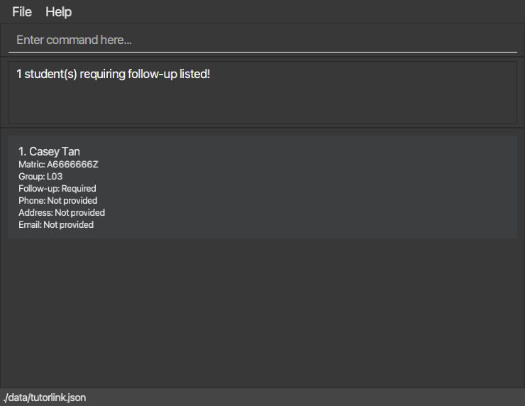

# Follow-up verification — 19 October 2026

Owner: Deron Chan (@dafadlaw). Scope: [#81](https://github.com/AY2627S1-CS2103T-T13-4/tp/issues/81).

## Delivery and review status

* [#83](https://github.com/AY2627S1-CS2103T-T13-4/tp/pull/83): minimal working mark, list, complete, persistence, and older-data support; merged at `6578af9857bd1220ea8d4cb9cfe9b5d6acf2e9fa`.
* [#84](https://github.com/AY2627S1-CS2103T-T13-4/tp/pull/84): User Guide, integration contract, model UML, sequence UML, and this verification record; awaiting teammate review.
* [#85](https://github.com/AY2627S1-CS2103T-T13-4/tp/pull/85): repeated-action feedback, edge-case regressions, and packaged restart acceptance checks; awaiting teammate review.

Each PR has its own branch. Core and documentation PRs were open concurrently. CI success is not a substitute for peer review; no peer approval is claimed for #83. Further merges are left to the team. Reviewer and readiness date remain for the team to agree.

## Automated checks

Candidate: `f3b9e654ef650eb3d23c255164e617416e4bebad` on `followup-edge-cases`.

* 386 JUnit tests passed, with no failures, errors, or skips.
* Main and test Checkstyle passed, and coverage reports were generated.
* Both `TutorLink.jar` and `TutorLink-mac-aarch64.jar` built successfully.
* User Guide and Developer Guide build with MarkBind 7.2.1. The changed model and follow-up sequence diagrams were rendered with PlantUML and visually inspected.

Commands for reproduction:

```sh
./gradlew test checkstyleMain checkstyleTest coverage shadowJar
./gradlew -PmacJavafxPlatform=mac-aarch64 shadowJar
python3 .github/smoke-test.py
```

Use a JDK 25 with JavaFX for the existing image-loading unit test. Use a plain JDK 25 for the packaged smoke check so that a bundled JavaFX installation cannot conceal packaging problems. The script chooses the JAR matching the Java runtime architecture. It requires a graphical desktop and writes evidence only under `build/packaged-smoke/`.

## Packaged acceptance result

The local GUI check passed on macOS 27.0.1 with a plain ARM64 JDK 25.0.1 (`25.0.1+8-LTS-27`). It used the ARM64 release JAR's own entry point, bundled JavaFX, real controls, command parser, and storage. It ran three separate application processes in one disposable data folder:

1. Load two older student records with no `requiresFollowUp` field; Casey has an existing remark and omitted contact details.
2. Find Casey by matriculation number and mark displayed index 1. Repeating the mark reports the current status.
3. Move Casey to L03, replace and clear tags, filter to another group, and run `followups`. Casey is found from the full roster with the status, remark, and absent contact fields preserved.
4. Reject invalid displayed indices, zero, an unknown action, and extra `followups` arguments without changing saved data or results.
5. Exit and restart. `followups` still finds Casey.
6. Complete Casey using the displayed index. Casey immediately leaves the list, and `followups` reports no outstanding students.
7. Find the retained student record and repeat completion; feedback reports no outstanding follow-up.
8. Exit and restart again. The follow-up list remains empty and both student records remain in the roster. Compare JSON to ensure completion changed only the status field.

The existing roster, tag-search, deletion-confirmation, optional-contact, restart, and invalid-data smoke checks also passed.




SHA-256 of the tested candidate packages:

| Package | SHA-256 |
| --- | --- |
| `TutorLink.jar` | `b3094e0d54b1bb350ef5e72b9562398576764026d95f9f1c0fbcc6c6dfb1b7ff` |
| `TutorLink-mac-aarch64.jar` | `bcdacc94a4029809b5c86e213fa8077e3bdfdcda6ab79d72dbc20b4b864653b4` |

Only the ARM64 JAR was launched locally. The x64 JAR was built; no local x64 GUI run is claimed.

## Remaining team integration and release gates

The remarks (#78) and sorting (#80) commands were not present in this candidate. The existing remark is retained, and `Student.withRemark` has set/replace/clear preservation tests, but this does not verify the future remark command. The remarks owner should use that copy method or the full constructor, and the sorting owner must expose the same order used by displayed indices. Run combined command tests after those PRs merge.

[#77](https://github.com/AY2627S1-CS2103T-T13-4/tp/issues/77) remains the release tracker. Rebuild and reverify the final integrated commit, refresh the draft release assets and checksums after production changes, and verify public downloads after publication. These candidate packages are verification outputs, not a published release. The team postmortem and other members' weekly tasks are outside this verification record.
